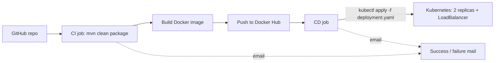

# jenkins

I used this repo to practise a CI/CD setup with Jenkins, Docker and Kubernetes. The app itself is a very small Spring Boot service; the interesting part is the pipeline files.

## The app
Java 21, Spring Boot, Maven. It runs on port 5000 and has three GET endpoints:
- `/`: returns the in-memory list of students
- `/load`: adds two hard-coded students to that list
- `/m`: returns a fixed string

Data is only kept in memory. There is no database code, even though the compose file starts Postgres.

## Pipelines
The two Jenkins pipelines are saved as text files:

`ci.txt` (CI job) has these stages:
1. Clone this repo (main branch)
2. `mvn clean package`
3. Build a Docker image from the `Dockerfile`
4. Log in to Docker Hub with a Jenkins credential (`dockerhub-creds`) and push the image with the `latest` tag
5. Trigger a second job named `cd pipeline`

It sends a success or failure email at the end.

`cd.txt` (CD job) clones the repo and runs `kubectl apply -f deployment.yaml`, then sends the same kind of email.

`deployment.yaml` defines a Deployment with 2 replicas of the pushed image on port 5000, plus a LoadBalancer Service on port 80. My comment in the pipeline calls the target an EKS cluster, and I have not included cluster setup here.

## Pipeline flow



## Running it locally
```
./mvnw clean package
java -jar target/docker-0.0.1-SNAPSHOT.jar
```
Then open http://localhost:5000. Or build the image with `docker build -t webapp .` and run it with `-p 5000:5000`.

## Notes
- The Jenkins jobs expect a Maven tool named `maveen`, the Docker Hub credential above and the email plugin, all configured in Jenkins.
- `Docker-compose.yml` maps port 8080 while the app and Dockerfile use 5000, so the compose file needs that port fixed before it works as is. Set your own database password there.
- It is a learning exercise, not a finished deployment.
